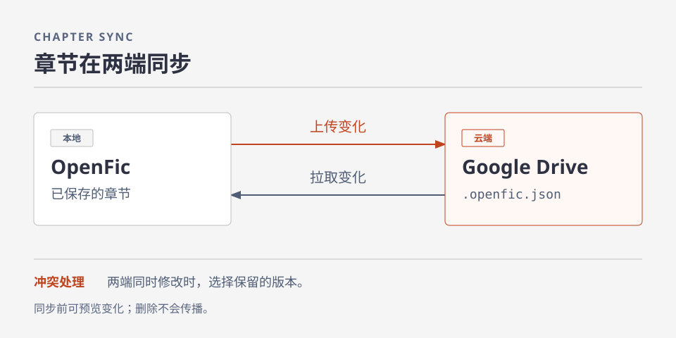

# Google Drive 章节同步

将 OpenFic 项目中已保存的章节与 Google Drive 同步。插件提供双向同步、仅上传和仅拉取三种方式，也可以先预览变化。

## 连接 Google Drive

1. 在 Google Cloud 中启用 Google Drive API，并创建 OAuth 客户端。
2. 在「设置 → 插件 → Google Drive 章节同步」中填写 Client ID 和 Client Secret。需要将文件放入指定文件夹时，再填写文件夹 ID。
3. 启用插件，在扩展侧栏打开「Google Drive 章节同步」，点击「连接 Google Drive」。
4. 将页面显示的 Redirect URI 添加到 OAuth 客户端允许的重定向 URI，然后打开 Google 授权页面完成连接。

插件请求 `drive.file` 权限，用于访问此应用获准访问的文件。也可以在同步页面导入已有的 OAuth access token；Client Secret 和令牌会加密保存。

保存插件配置时，Client ID 和 Client Secret 均为必填；已保存的 Client Secret 留空时会保留原值。

## 同步章节

在插件页面选择项目和同步方向，先点击「预览变化」查看结果，再点击「立即同步」。编辑器工具栏中的「云同步」也可以先保存当前编辑内容，再同步当前项目。

- **双向同步**：根据上次同步后的状态，上传本地变化或拉取云端变化。
- **仅上传本地变化**：将本地章节变化上传到 Google Drive。
- **仅拉取云端变化**：将云端章节变化拉取到本地；云端存在而本地没有的章节会导入项目的第一个卷。

章节以 `.openfic.json` 文件保存在 Google Drive。插件不会传播删除操作；如果同一章节在本地和云端都发生了变化，插件会报告冲突，由你选择使用本地版本或云端版本并确认覆盖。

Agent 的 `sync_chapters` 工具显示为“同步章节”，属于“云同步”分类，默认不启用；需要在智能体设置中选择该分类。工具只上传已保存章节；下载和冲突处理需要在插件页面操作。
